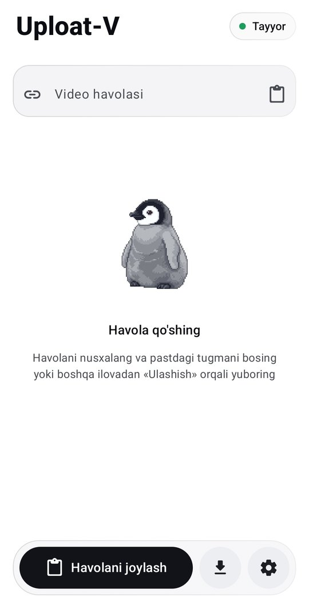
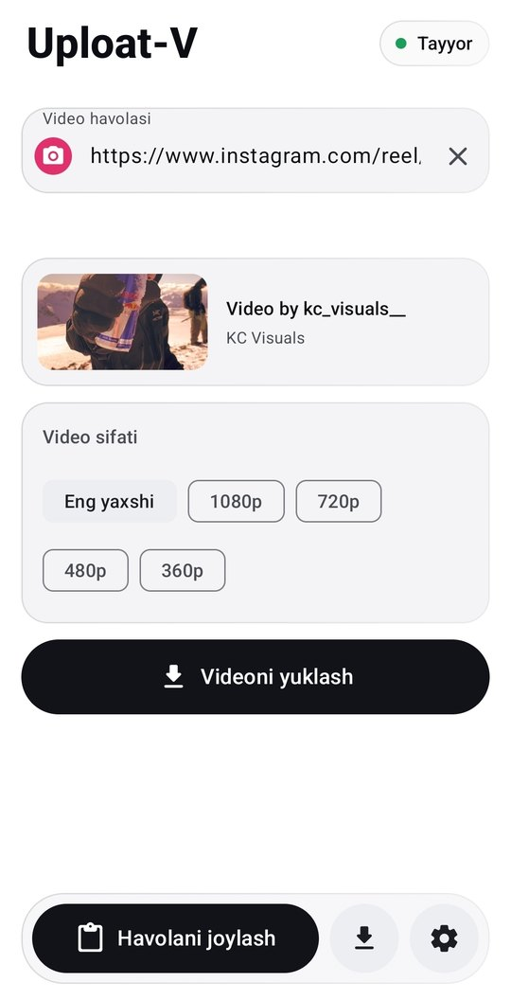
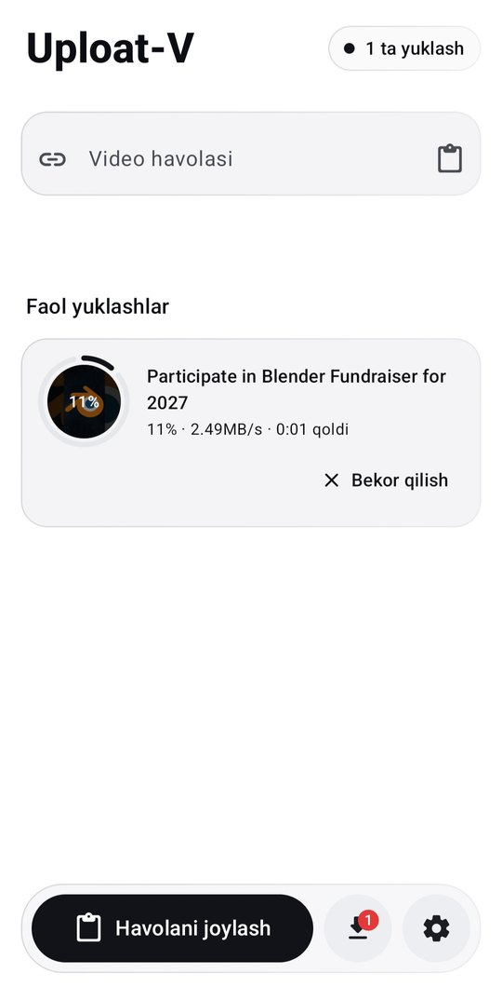
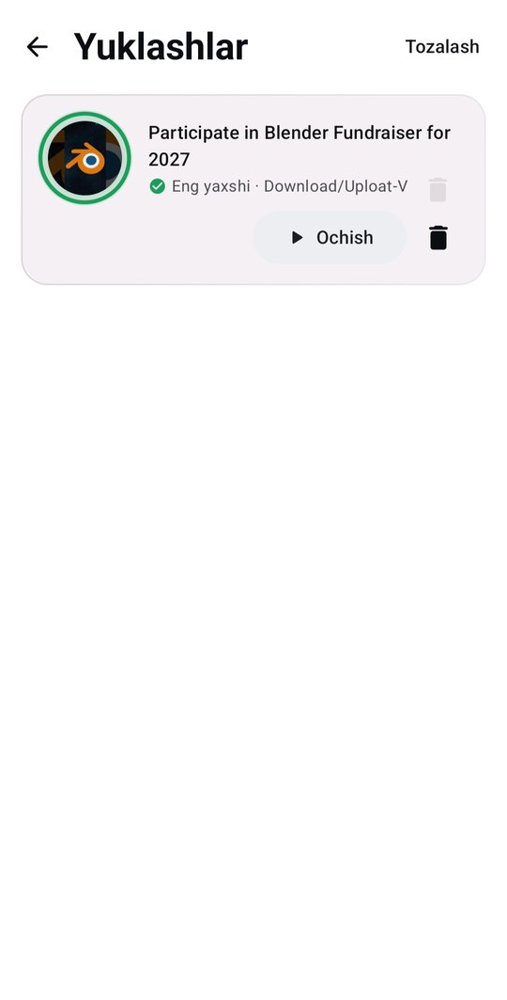
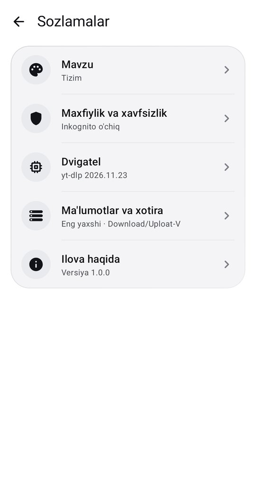
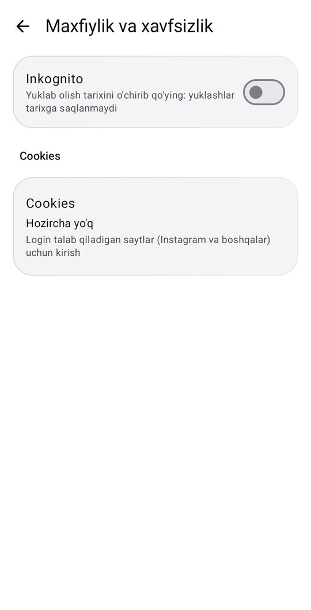
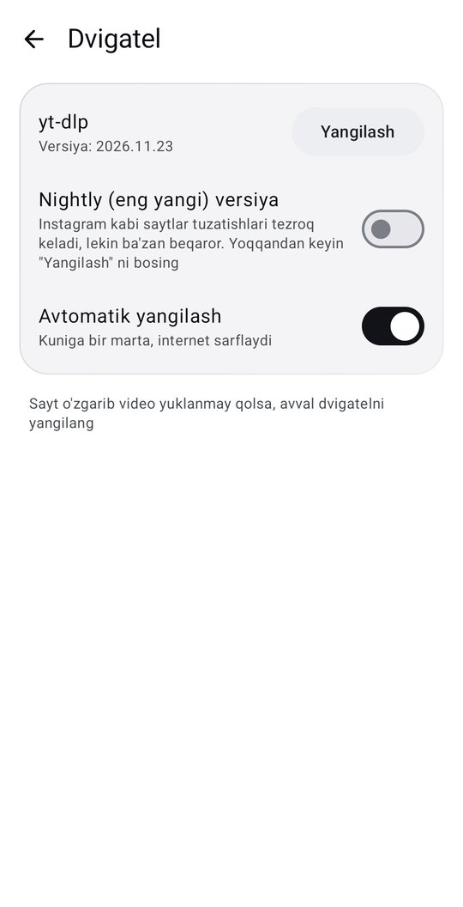
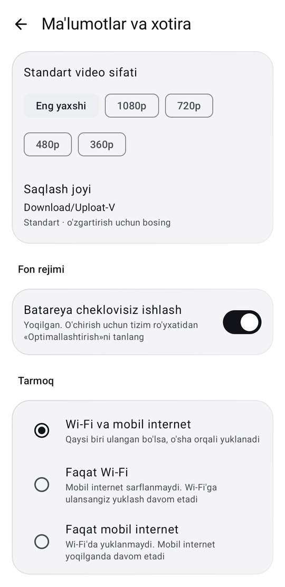
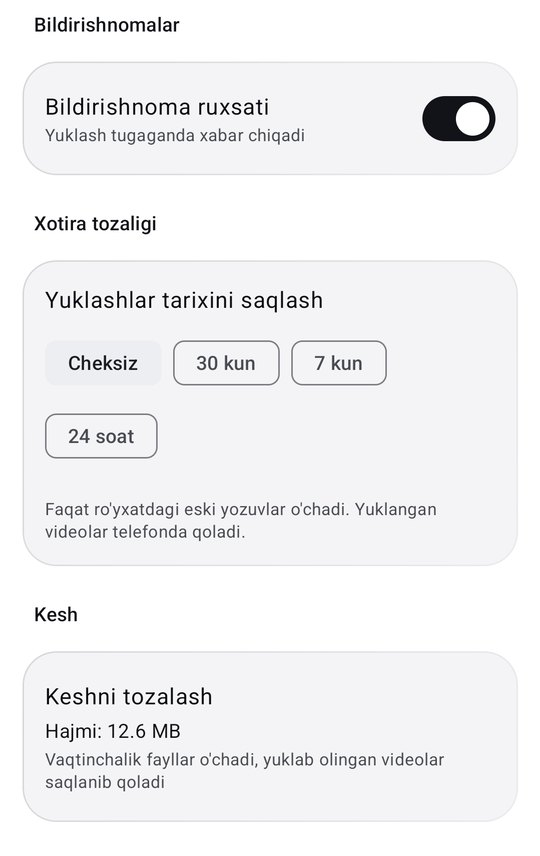
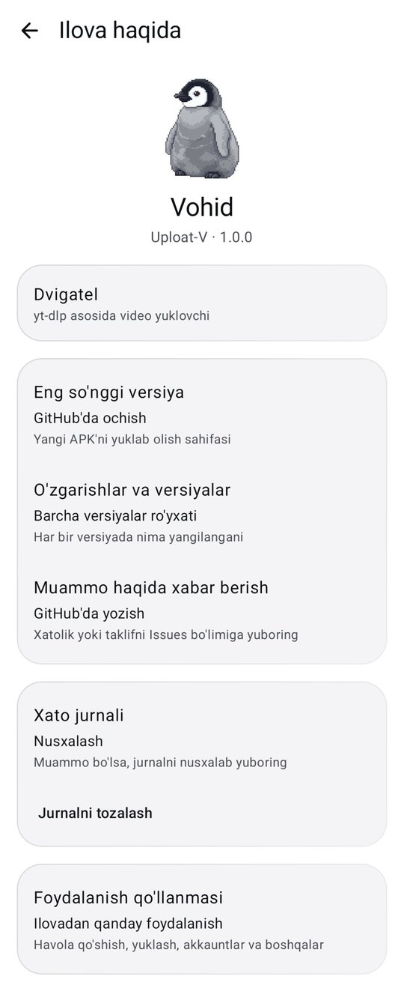

<p align="center">
  
</p>

<h1 align="center">Uploat-V</h1>

<p align="center">
  Android uchun yengil, ishonchli <b>video yuklovchi</b>.<br>
  Dvigatel: <a href="https://github.com/yt-dlp/yt-dlp">yt-dlp</a> · Kotlin · Jetpack Compose
</p>

<p align="center">
  <a href="../../releases/latest/download/Uploat-V.apk"></a>
</p>

<p align="center">
  <a href="../../releases/latest"></a>
  
  <a href="LICENSE"></a>
  <a href="../../actions/workflows/build.yml"></a>
</p>

<p align="center">
  <a href="#imkoniyatlar">Imkoniyatlar</a> ·
  <a href="#qanday-ishlatiladi">Qanday ishlatiladi</a> ·
  <a href="#ornatish">O'rnatish</a> ·
  <a href="#tez-tez-soraladigan-savollar">Savollar</a> ·
  <a href="#litsenziya">Litsenziya</a>
</p>

---

## Ilova ko'rinishi

<table>
  <tr>
    <td align="center" valign="top"><picture><source media="(prefers-color-scheme: dark)" srcset="docs/screenshots/dark-1-bosh-sahifa.jpg"></picture></td>
    <td align="center" valign="top"><picture><source media="(prefers-color-scheme: dark)" srcset="docs/screenshots/dark-2-sifat.jpg"></picture></td>
    <td align="center" valign="top"><picture><source media="(prefers-color-scheme: dark)" srcset="docs/screenshots/dark-3-yuklash.jpg"></picture></td>
    <td align="center" valign="top"><picture><source media="(prefers-color-scheme: dark)" srcset="docs/screenshots/dark-4-yuklashlar.jpg"></picture></td>
    <td align="center" valign="top"><picture><source media="(prefers-color-scheme: dark)" srcset="docs/screenshots/dark-5-sozlamalar.jpg"></picture></td>
  </tr>
  <tr>
    <td align="center">Bosh sahifa</td>
    <td align="center">Sifat tanlash</td>
    <td align="center">Yuklash jarayoni</td>
    <td align="center">Yuklashlar</td>
    <td align="center">Sozlamalar</td>
  </tr>
</table>

<sub>Rasmlar GitHub mavzusiga qarab yorug' yoki qorong'i ko'rinadi. Namuna video: Blender Foundation kanalidan.</sub>

<details>
<summary><b>Sozlamalar skrinshotlari</b></summary>
<br>

<table>
  <tr>
    <td align="center" valign="top"><picture><source media="(prefers-color-scheme: dark)" srcset="docs/screenshots/dark-6-maxfiylik.jpg"></picture></td>
    <td align="center" valign="top"><picture><source media="(prefers-color-scheme: dark)" srcset="docs/screenshots/dark-7-dvigatel.jpg"></picture></td>
    <td align="center" valign="top"><picture><source media="(prefers-color-scheme: dark)" srcset="docs/screenshots/dark-8a-malumotlar-1.jpg"></picture></td>
    <td align="center" valign="top"><picture><source media="(prefers-color-scheme: dark)" srcset="docs/screenshots/dark-8b-malumotlar-2.jpg"></picture></td>
    <td align="center" valign="top"><picture><source media="(prefers-color-scheme: dark)" srcset="docs/screenshots/dark-9-ilova-haqida.jpg"></picture></td>
  </tr>
  <tr>
    <td align="center">Maxfiylik va xavfsizlik</td>
    <td align="center">Dvigatel</td>
    <td align="center">Ma'lumotlar va xotira (1)</td>
    <td align="center">Ma'lumotlar va xotira (2)</td>
    <td align="center">Ilova haqida</td>
  </tr>
</table>

</details>

## Imkoniyatlar

- Havola orqali video yuklash, boshqa ilovadan «Ulashish» ham ishlaydi
- Sifatni tanlash (360p dan 1080p gacha), fayl hajmi oldindan ko'rinadi
- Playlistlar va fon rejimida yuklash (bir vaqtda 2 tagacha)
- Uzilgan yuklash davom etadi, internet qaytganda avtomatik qayta urinadi
- Tarmoq rejimi: Wi-Fi va mobil internet / faqat Wi-Fi / faqat mobil internet
- Yuklash tarixini avtomatik tozalash (cheksiz, 30 kun, 7 kun yoki 24 soat)
- Yorug' va qorong'i mavzu

## Qanday ishlatiladi

1. Videoning havolasini nusxalang (YouTube, Instagram va boshqa ilovada «Havolani nusxalash»).
2. Uploat-V'ni oching: nusxalangan havolani ilova o'zi taklif qiladi, yoki o'zingiz joylang. Boshqa ilovadan «Ulashish» → «Tezkor yuklash» ni tanlasangiz, Uploat-V ochilmasdan fonda yuklaydi.
3. Sifatni tanlab «Yuklash» ni bosing. Tugagach bildirishnoma keladi, video `Download/Uploat-V` papkasida bo'ladi.

## Qaysi saytlar ishlaydi

YouTube, Instagram, TikTok, Facebook, X (Twitter), Vimeo, Reddit va yt-dlp qo'llab-quvvatlaydigan boshqa ko'plab saytlar ([to'liq ro'yxat](https://github.com/yt-dlp/yt-dlp/blob/master/supportedsites.md)). Saytlar o'zgarib turgani uchun ba'zan biror sayt vaqtincha ishlamay qolishi mumkin: bunday paytda yt-dlp ni yangilash yordam beradi.

<details>
<summary><h2>Tez-tez so'raladigan savollar</h2></summary>

**Instagram yoki boshqa sayt «kirish kerak» deydi.**
Sozlamalar → Cookies bo'limida o'sha saytga kiring. Ilova sizning nomingizdan yuklaydi. Parol saqlanmaydi, faqat kirish belgisi (cookie) saqlanadi.

**Video yuklanmayapti yoki «xato» chiqyapti.**
Sozlamalardan yt-dlp ni yangilang (bosh sahifadagi sariq kartochka ham shuni qiladi). Yordam bermasa, Sozlamalar → Ilova haqida → «Xato jurnali» → Nusxalash va [shu yerga](../../issues/new/choose) yuboring.

**Nega ilova bildirishnoma va batareya ruxsatini so'raydi?**
Bildirishnoma yuklash tugaganini bildirish uchun. Batareya cheklovisiz ishlash esa ekran o'chiq paytda yuklash to'xtab qolmasligi uchun. Ikkalasini ham Sozlamalardan o'chirib qo'yish mumkin.

**Internet uzilib qolsa nima bo'ladi?**
Yuklash to'xtaydi va internet qaytganda o'zi davom etadi, boshidan boshlamaydi.

**Videolar qayerda saqlanadi?**
`Download/Uploat-V` papkasida. Sozlamalarda boshqa papkani tanlash mumkin.

</details>

<details>
<summary><h2>Cheklovlar</h2></summary>

- **APK hajmi taxminan 80 MB:** ichida yt-dlp va ffmpeg bor.
- **Faqat arm64 qurilmalar** (deyarli barcha zamonaviy telefonlar) va Android 10 yoki yangisi.
- **Instagram kabi saytlar** ba'zan kirishni talab qiladi: Sozlamalar → Cookies orqali kirsangiz ishlaydi. Saytlar o'zgarib turgani uchun ba'zan yt-dlp yangilanishini kutish kerak bo'ladi.
- **Faqat video yuklanadi**, alohida audio yuklash yo'q.
- **Play Market'da yo'q:** ilova o'zi yangilanmaydi, yangi versiyani Releases'dan qo'lda yuklaysiz.

</details>

## Tillar

O'zbekcha (mavjud) · English (tez orada)

## O'rnatish

1. [**Releases**](../../releases/latest) bo'limidan `Uploat-V.apk` ni yuklab oling.
2. APK'ni oching va «Noma'lum manbalardan o'rnatish» ruxsatini bering.
3. Birinchi ochilganda ilova bildirishnoma va xotira ruxsatlarini so'raydi.

Talablar: Android 10 va undan yuqori, arm64 qurilma.

<details>
<summary><b>APK haqiqiyligini tekshirish</b></summary>

Rasmiy relizlar doimiy kalit bilan imzolangan. Imzo barmoq izi (SHA-256):

```
CD:2D:5B:34:FD:78:C5:77:71:EC:37:63:94:63:0F:55:DC:0F:56:72:89:E3:90:57:CC:EC:89:A8:78:FD:BD:FD
```

Tekshirish: `apksigner verify --print-certs Uploat-V.apk`. Boshqa barmoq izi chiqsa, bu rasmiy APK emas, o'rnatmang.

</details>

**Yangilash:** yangi APK'ni yuklab, eskisining ustiga o'rnating. Tarix va sozlamalar saqlanadi.

<details>
<summary><h2>Dasturchilar uchun</h2></summary>

```bash
./gradlew testDebugUnitTest   # testlar
./gradlew assembleRelease     # APK
```

JDK 17 kerak. Yangi versiya chiqarish: Actions → Build APK → Run workflow, versiyani yozing (masalan `1.0.1`).

</details>

## Litsenziya

[GPL-3.0](LICENSE)

Uploat-V faqat shaxsiy foydalanish uchun. Videolarni yuklashda kontent egalarining huquqlari va saytlarning foydalanish qoidalariga rioya qiling: mas'uliyat foydalanuvchida.

## Minnatdorchilik

[yt-dlp](https://github.com/yt-dlp/yt-dlp), [youtubedl-android](https://github.com/JunkFood02/youtubedl-android), [Haze](https://github.com/chrisbanes/haze), [Coil](https://github.com/coil-kt/coil), [Seal](https://github.com/JunkFood02/Seal) (ilhom manbai).

⭐ Ilova yoqqan bo'lsa, loyihaga **Star** bosib qo'llab-quvvatlang. Oldindan rahmat!
